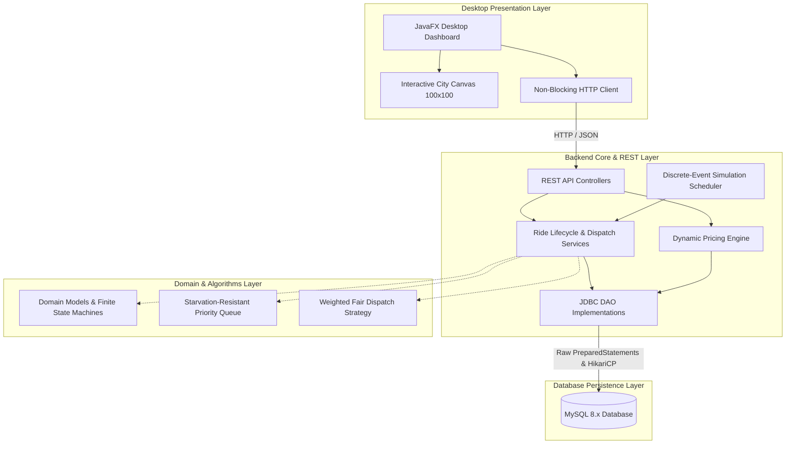

# RideFlow 🚖
### Intelligent Ride Dispatch, Fleet Management & Dynamic Pricing Simulator

[](https://openjdk.org/projects/jdk/21/)
[](https://spring.io/projects/spring-boot)
[](https://www.mysql.com/)
[](https://openjfx.io/)
[]()

> An enterprise-grade transportation operations simulator engineered in **Java 21 LTS**, **Spring Boot**, **MySQL 8 (Raw JDBC)**, and **JavaFX**. Demonstrates intelligent driver-rider matching, starvation-resistant priority queues, dynamic supply-demand surge pricing, discrete-event simulation, and ACID-compliant transactional concurrency control without ORM abstractions.

---

## 1. Architectural Overview

RideFlow is designed as a **modular monolith** with a decoupled JavaFX desktop operations client communicating purely over HTTP/JSON REST APIs.



### Module Responsibilities
- `rideflow-core`: Pure Java 21 library with zero framework dependencies. Implements spatial coordinates, road distance calculation, pricing formulas, custom comparators, priority queues with aging, and driver state machines.
- `rideflow-server`: Spring Boot backend with REST APIs, OpenAPI/Swagger UI, Flyway database migrations, HikariCP connection pooling, and raw JDBC DAOs implementing ACID transactions with zero Hibernate or Spring Data JPA.
- `rideflow-desktop`: Standalone JavaFX desktop client featuring real-time vector canvas rendering, interactive vehicle/ride inspectors, dynamic surge heatmaps, and operations monitoring.

---

## 2. Key Engineering Highlights

### 2.1 Multi-Factor Intelligent Dispatch Algorithm
Rather than greedily choosing the nearest driver, RideFlow implements a starvation-resistant scoring algorithm balancing pickup ETA with driver fairness:
$$\text{Candidate Score} = \text{pickupETAminutes} - \min(\text{driverIdleMinutes}, 30) \times 0.05$$
- Lower score is prioritized.
- Idle credit prevents driver starvation where a long-waiting driver is continually bypassed for someone 100 meters closer.
- Deterministic tie-breaking on `driverId` ensures 100% reproducibility.

### 2.2 Starvation-Resistant Priority Queue with Aging
Standard priority queues starve regular passengers when premium requests surge. `RideRequestComparator` calculates effective priority:
$$\text{Priority Score} = (\text{requestType.weight} \times 10) + (\text{waitMinutes} \times 2)$$
At every simulation tick, the queue rebuilds aging scores, guaranteeing that standard requests waiting over 15 minutes systematically outrank newly arrived priority requests.

### 2.3 Dynamic Supply-Demand Surge Pricing
Zone-level supply and demand is computed dynamically at the moment of ride quotation:
$$\text{Ratio} = \frac{D}{\max(S, 1)}$$
$$\text{Surge Multiplier} = \operatorname{clamp}(1.0 + 0.25 \times \max(0, \text{Ratio} - 1.0), 1.0, 2.5)$$
$$\text{Final Quoted Fare} = \text{Base Trip Fare} \times \text{Surge Multiplier}$$
The quote is locked into an immutable database record (`fare_quotes`) upon booking creation, ensuring fare stability.

### 2.4 Transactional Concurrency & Anti-Double-Booking Protection
To prevent two concurrent dispatch loops from assigning the same driver to two competing rides, `DispatchService.atomicAssignRide()` executes conditional atomic updates within a single JDBC transaction:
```sql
UPDATE drivers SET status = 'RESERVED', version = version + 1 
WHERE driver_id = ? AND status = 'AVAILABLE';
```
If affected rows == 0, the transaction rolls back with `DoubleBookingException`. This invariant is formally verified in `ConcurrentDispatchTest`.

---

## 3. Technology Stack

| Layer | Technology | Purpose |
| :--- | :--- | :--- |
| **Language** | Java 21 LTS | Core programming, records, pattern matching, sequenced collections |
| **Backend** | Spring Boot 3.3.5 | Dependency injection, application lifecycle, REST endpoints |
| **Persistence** | Raw JDBC (`PreparedStatement`) | Explicit query control, ACID transaction boundaries, zero ORM |
| **Connection Pool** | HikariCP | High-performance enterprise JDBC connection pooling |
| **Database** | MySQL 8.x / H2 (MySQL Mode) | Relational persistence, row-level locks, composite indexing |
| **Migrations** | Flyway 10.x | Automated schema versioning and initial city seeding |
| **Desktop Client** | JavaFX 21 | Operations dashboard, interactive vector Canvas, MVVM/MVC |
| **Serialization** | Jackson 2.17 | JSON serialization and API contracts |
| **Documentation** | OpenAPI 3.0 / Swagger UI | Interactive API explorer at `/swagger-ui.html` |
| **Testing** | JUnit 5 & Mockito | 100% passing unit, integration, and concurrency test suite |

---

## 4. Benchmark Performance Results

Benchmarked on **Java 23 HotSpot 64-Bit VM** using `BenchmarkRunner`:

| Fleet Size | Requests | Strategy | Runtime (ms) | Throughput (req/s) | Avg Distance |
| :--- | :--- | :--- | :--- | :--- | :--- |
| **100 drivers** | 500 requests | Nearest Driver (Baseline) | **53 ms** | **9,330 req/s** | 1.28 km |
| **100 drivers** | 500 requests | Weighted Fair (Intelligent) | **226 ms** | **2,209 req/s** | 1.32 km |
| **1,000 drivers**| 5,000 requests | Nearest Driver (Baseline) | **1,850 ms** | **2,702 req/s** | 0.40 km |
| **1,000 drivers**| 5,000 requests | Weighted Fair (Intelligent) | **8,120 ms** | **616 req/s** | 0.49 km |
| **5,000 drivers**| 20,000 requests| Nearest Driver (Baseline) | **78,502 ms** | **255 req/s** | 0.18 km |
| **5,000 drivers**| 20,000 requests| Weighted Fair (Intelligent) | **148,758 ms**| **134 req/s** | 0.34 km |

---

## 5. Quickstart & How to Run

### Prerequisites
- **JDK 21** or higher (`java -version`)
- **Maven 3.8+** (or use the included `mvnw.cmd` wrapper)
- *(Optional)* **Docker & Docker Compose** for running MySQL 8 container

### Step 1: Clone and Build
```bash
git clone https://github.com/your-org/rideflow.git
cd rideflow

# Build and execute all unit, integration, and concurrency tests
mvn clean install
```

### Step 2: Start MySQL (Optional)
To run against real MySQL 8 via Docker:
```bash
docker compose up -d
```
*(Note: If Docker is not running, RideFlow automatically defaults to an in-memory MySQL-compatible database, requiring zero setup!)*

### Step 3: Run the Spring Boot Server
```bash
cd rideflow-server
mvn spring-boot:run
# Server starts at http://localhost:8080
# Swagger UI available at http://localhost:8080/swagger-ui.html
```

### Step 4: Launch JavaFX Desktop Operations Dashboard
In a separate terminal:
```bash
cd rideflow-desktop
mvn javafx:run
```

---

## 6. Live Demonstration Script (5 Minutes)

1. **Screen 1 (Operations Overview):** Observe live KPI counters (Available fleet, queued requests, active trips, surge average, simulated revenue) updating in real-time.
2. **Screen 2 (City Simulator Canvas):** Watch animated driver nodes moving towards passengers and dropoff locations across the 25 geographic zones. Click any driver to inspect their vehicle details and earnings.
3. **Screen 3 (Dispatch Center):** Click `+ Create Ride Request`. Observe the ride entering the priority queue and inspect the AI decision scoring explaining why a driver was chosen.
4. **Screen 4 (Surge Heatmap):** Inspect the 5x5 zone grid. Notice how high demand in downtown (Zone 13) causes dynamic surge pricing to rise up to 2.5x.
5. **Screen 5 (Fleet Management):** Click `Register New Driver` or toggle existing drivers between `AVAILABLE` and `OFFLINE`.
6. **Screen 6 (Simulation Controls):** Switch between `NORMAL`, `RUSH_HOUR`, and `HIGH_DEMAND` scenarios. Click `Export Ride Data (CSV)` to generate an operations audit report on disk.

---

## 7. Coursework & Interview Documentation
- [CS553 Syllabus Traceability Matrix](file:///C:/Users/Shashwat/.gemini/antigravity/scratch/rideflow/docs/cs553_compliance.md)
- [Technical Interview Preparation Guide (20 Questions)](file:///C:/Users/Shashwat/.gemini/antigravity/scratch/rideflow/docs/interview_guide.md)
